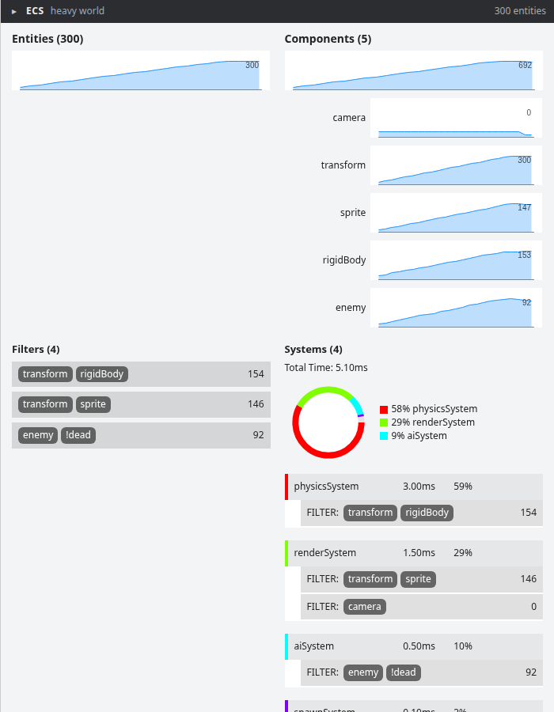

# ecs

data oriented, functional entity component system.

[](https://github.com/mreinstein/ecs/actions/workflows/main.yml)

## what?

Many games and simulations are built around object oriented classes and scene graphs.

Scene graphs and object hierarchies often end up being a mess, where eventually one ends up facing difficult decisions around questions like "where does this particular piece of logic/state live?" There are certain bits of logic/state that cross-cut and don't fit cleanly in one place, and code and logic become entangled in various places in the graph.  Not all relationships in a game/simulation are modeled appropriately with parent/child relationships which is why we get into these situations.


ECS is an alternative architecture:

* **E**ntities have 0 or more components
* **C**omponents are pure data and have no behavior
* **S**ystems have behavior but no data

The entire ecs module here is about 100 lines of code, and offers an O(1) iterator at run time for querying for entities within systems.


## usage example

This is a minimal example of what you can do with `ecs`, illustrating how to declare
your entities, components, and systems.

```javascript
import ECS      from 'ecs'
import Keyboard from './my/game/keyboard.js'
import clamp    from 'clamp'


// generates a new entity component system
const world = ECS.addWorld()


// set up the player
const PLAYER = ECS.addEntity(world)
ECS.addComponent(world, PLAYER, 'position', { x: 15, y: 23 })
ECS.addComponent(world, PLAYER, 'moveable', { dx: 0, dy: 0 })


// update entity velocity based on key pressed
function keyboardControlSystem (world) {
    // called each game loop
    const onUpdate = function (dt) {
        // get all of the entities in the world that pass the filter
        for (const entity of ECS.getEntities(world, [ 'moveable' ])) {
            // update the entity position according to what is pressed
            if (Keyboard.keyPressed('up'))
                entity.moveable.dy -= 1
            if (Keyboard.keyPressed('down'))
                entity.moveable.dy += 1
            if (Keyboard.keyPressed('left'))
                entity.moveable.dx -= 1
            if (Keyboard.keyPressed('right'))
                entity.moveable.dx += 1

           entity.moveable.dx = clamp(entity.moveable.dx, -10, 10)
           entity.moveable.dy = clamp(entity.moveable.dy, -10, 10)
        }
    }

    return { onUpdate }
}


function movementSystem (world) {
    const onUpdate = function (dt) {
        for (const entity of ECS.getEntities(world, [ 'position', 'moveable' ])) {
            entity.position.x += entity.moveable.dx
            entity.position.y += entity.moveable.dy
        }
    }

    return { onUpdate }
}


function rendererSystem (world) {

    const RENDERABLE_FILTER = [ 'renderable' ]

    // data structure to store all entities that were added or removed last frame
    const result = {
        count: 0,
        entries: new Array(100)
    }

    const onUpdate = function (dt) {

        // optional 3rd parameter, can be 'added' or 'removed'. populates the list of entities that were
        // added since the last ECS.cleanup(...) call
        ECS.getEntities(world, RENDERABLE_FILTER, 'added', result)
        for (let i=0; i < result.count; i++)
            console.log('added new entity:', result.entries[i])
        
        // result will be filled in with a reference to all entries removed last frame
        ECS.getEntities(world, RENDERABLE_FILTER, 'removed', result)
        for (let i=0; i < result.count; i++)
            console.log('removed entity:', result.entries[i])
    }

    return { onUpdate }
}


ECS.addSystem(world, keyboardControlSystem)
ECS.addSystem(world, movementSystem)
ECS.addSystem(world, rendererSystem)


let currentTime = performance.now()

function gameLoop () {
    const newTime = performance.now()
    const frameTime = newTime - currentTime  // in milliseconds, e.g. 16.64356
    currentTime = newTime

    // run onUpdate for all added systems
    ECS.update(world, frameTime)

    // necessary cleanup step at the end of each frame loop
    ECS.cleanup(world)

    requestAnimationFrame(gameLoop)
}


// finally start the game loop
gameLoop()
```


### get a single entity

Sometimes you just want a single entity, like for singleton objects (player's character for example).

```javascript
const h = ECS.getEntities(world, [ 'hero' ])[0]  // kinda kludgy

const h = ECS.getEntity(world, [ 'hero' ])       // same result, less typing
```


### not filter

Sometimes it's useful to query by components that are _not_ present:

```javascript
// get all entities that have a transform component but lack a hero component
const entities = ECS.getEntities(world, [ 'transform', '!hero' ])
```


### deferred component removal

By default, when a component is removed from an entity, it is deferred until the next frame.

This is typically what you want, but if you want to immediately remove a component, you can do this:

```javascript
const componentName = 'aabb'

const world = ECS.addWorld()
const entity = ECS.addEntity(world)
ECS.addComponent(world, entity, componentName)


const deferredRemoval = false  // by default this is true. setting it to false immediately removes the component
ECS.removeComponent(world, entity, componentName, deferredRemoval)

ECS.getEntities(world, [ componentName ]).length  // because we are not deferring the removal, length === 0 
```


### deferred entity removal

By default, when an entity is removed it is deferred until the next frame.

This is typically what you want, but if you want to immediately remove an entity, you can do this:

```javascript

const world = ECS.addWorld()
const entity = ECS.addEntity(world)
ECS.addComponent(world, entity, 'test_component')


const deferredRemoval = false  // by default this is true. setting it to false immediately removes the component
ECS.removeEntity(world, entity, deferredRemoval)

ECS.getEntities(world, [ 'test_component' ]).length  // because we are not deferring the removal, length === 0 
```


### removeEntities Example

You can use `ECS.removeEntities` to remove all entities with a specified component. For example, if you have entities with an `ephemeral` component and want to delete them from the world, you can do this:

```javascript
// remove all entities that have an 'ephemeral' component
ECS.removeEntities(world, ['ephemeral']);
```

The `removeEntities` function also supports the **not filter**, which allows you to specify components that should **not** be present on the entities you want to remove. For example, to remove entities that have a `transform` component but lack a `health` component, you can use the following code:

```javascript
// remove all entities that have a 'transform' component and lack a 'health' component
ECS.removeEntities(world, ['transform', '!health']);
```

This functionality can be useful for cleaning up entities that meet specific component criteria in your world.


### get entity by unique id

ECS will generate a unique integer id for every entity created in a world:

```javascript
const world = ECS.addWorld()
const e = ECS.addEntity(world)
const e2 = ECS.addEntity(world)

const id1 = ECS.getEntityId(world, e)
const id2 = ECS.getEntityId(world, e2)

console.log(id1)  // 1
console.log(id2)  // 2
```

You can then lookup  this entity directly:
```javascript
const e = ECS.getEntityById(world, id1)  // e is the entity
```

This can be useful in cases where you need to reference an entity from another context. for example,
if you're running a networked simulation and need to refer to a specific entity across peers.


### devtools panel

If you'd like to see a real time view of the data in your ECS powered program, there is an in-page devtools panel. No browser extension needed:

```javascript
import ECS                from 'ecs'
import { createDevtools } from 'ecs/devtools.js'

const world = ECS.addWorld()

const devtools = createDevtools(world)
```



It renders a floating panel docked to the right edge of the window (styles are isolated in a shadow DOM) showing
entity and component counts over time, active filters, and how long each system takes per frame.

* press <code>`</code> or click the header to collapse/expand it
* drag the left edge to resize it; wider panels switch to a 2 or 3 column layout
* open/closed state and width are remembered in `localStorage`

Options (all optional):

```javascript
const devtools = createDevtools(world, {
    open: true,        // start expanded
    hotkey: '`',       // toggle key, or false to disable
    sampleRate: 250,   // minimum ms between samples
    maxSamples: 100,   // samples kept per graph
    width: 420,        // initial width in pixels
    name: 'main',      // label shown in the header, handy with multiple worlds
    parent: document.body,
})

devtools.toggle()   // also .open() and .close()
devtools.destroy()  // removes the panel and detaches from the world
```

The panel runs its own `requestAnimationFrame` loop that reads `world.stats` (so it pauses in hidden tabs).
`world.stats` describes the last completed frame, which `ECS.cleanup()` publishes, so call `cleanup` once per
frame as usual. ecs itself has no knowledge of the devtools.

`ecs/devtools.js` is browser-only and depends on `snabby` and `snabbdom-timeline` (installed with `ecs`).
Bundlers (vite, esbuild, webpack, etc.) handle it out of the box. If you're using native ES modules with an
import map, see [examples/events.html](examples/events.html).

### Typescript Support

Typescript and named exports are also supported:

```typescript
import {
    default as ECS,
    addWorld,
    addEntity,
    addComponent,
    getEntities,
    addSystem,
    SystemFunction,
    SystemUpdateFunction
} from 'ecs'

const world = addWorld()

const PLAYER = addEntity(world);
addComponent(world, PLAYER, 'position', { x: 15, y: 23 })
addComponent(world, PLAYER, 'moveable', { dx: 0, dy: 0 })

const movementSystem: SystemFunction = function (world) {
    const onUpdate: SystemUpdateFunction = function (dt) {
        for (const entity of getEntities(world, ['position', 'moveable'])) {
            entity.position.x += entity.moveable.dx
            entity.position.y += entity.moveable.dy
        }
    }


    return { onUpdate }
}

addSystem(world, movementSystem);

let currentTime = performance.now();

function gameLoop() {
    const newTime = performance.now()
    const frameTime = newTime - currentTime  // in milliseconds, e.g. 16.64356
    currentTime = newTime

    // run onUpdate for all added systems
    ECS.update(world, frameTime)

    // necessary cleanup step at the end of each frame loop
    ECS.cleanup(world)

    requestAnimationFrame(gameLoop)
}


// finally start the game loop
gameLoop()
```

### references, honorable mentions, etc.

If you'd like to explore other data oriented, highly performant ECS implementations, check out https://github.com/NateTheGreatt/bitECS I haven't personally used it yet, but browsing over the project, looks legit!
