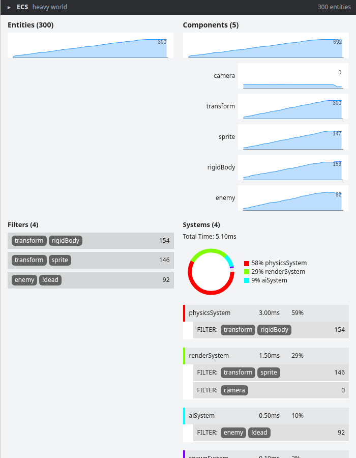

# ecs-devtools

An in-page devtools panel for [ecs](https://github.com/mreinstein/ecs).



It renders a floating panel docked to the right edge of the window showing
entity and component counts over time, active filters, and how long each system takes per frame.


## usage

Requires ecs `>= 0.24.0`

```
npm install --save-dev ecs-devtools
```

```javascript
import ECS                from 'ecs'
import { createDevtools } from 'ecs-devtools'

const world = ECS.addWorld()

const devtools = createDevtools(world)
```

* press <code>`</code> or click the header to collapse/expand it
* drag the left edge to resize it; wider panels switch to a 2 or 3 column layout

Options (all optional):

```javascript
const devtools = createDevtools(world, {
    open: true,        // start expanded
    hotkey: '`',       // toggle key, or false to disable
    sampleRate: 250,   // minimum ms between samples
    maxSamples: 100,   // samples kept per graph
    width: 420,        // initial width in pixels
    name: 'main',      // label shown in the header, handy with multiple worlds
    parent: document.body,
})

devtools.toggle()   // also .open() and .close()
devtools.destroy()  // removes the panel and stops its update loop
```

